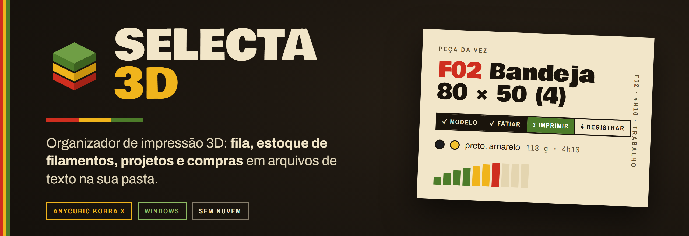
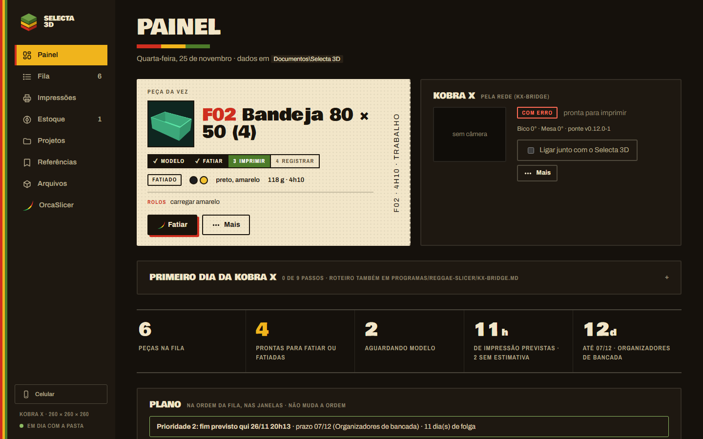
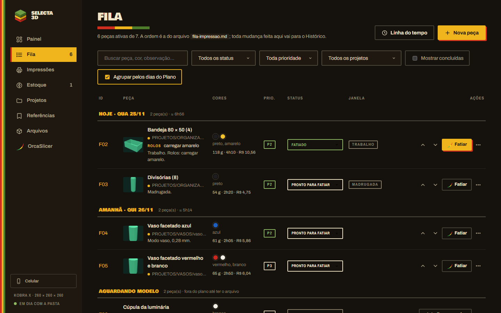
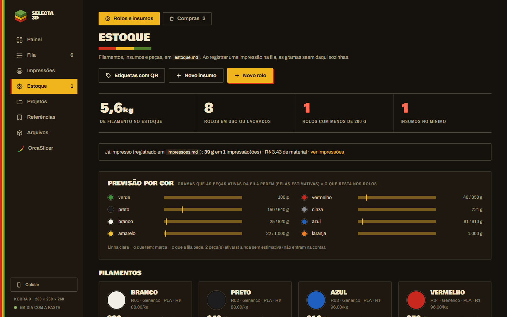
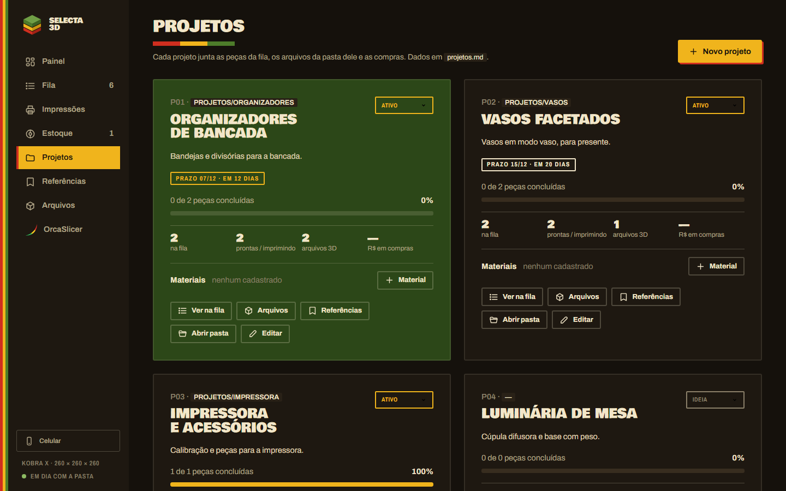
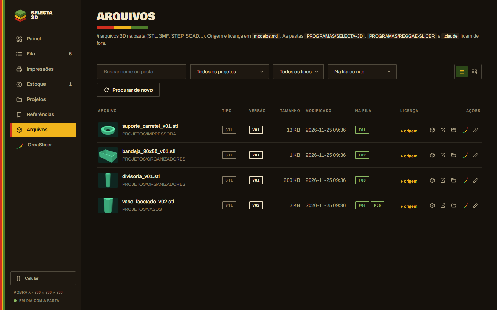

# Selecta 3D

Programa para Windows que organiza a impressão 3D de quem tem uma **Anycubic Kobra X**: fila de peças, estoque de filamentos, compras, projetos, referências de outros sites, estimativas e histórico de impressões. Tudo fica em arquivos de texto (`.md`) numa pasta sua; não há conta, nuvem nem banco de dados.

> [!IMPORTANT]
> **Projeto pessoal, compartilhado para testes e como referência para outros projetos.** Eu não dou suporte ao programa para outras pessoas: issues e pedidos podem ficar sem resposta, e não há garantia.
>
> Para adaptar o Selecta 3D à sua impressora e à sua rotina de impressão 3D, use um agente de IA como o **[Claude Code](https://claude.com/claude-code)** ou o **[Codex](https://openai.com/codex)**: aponte o agente para este repositório e para a sua pasta de impressão, e peça as mudanças que quiser. É assim que o programa é feito e mantido. Os dados são arquivos `.md` legíveis justamente para que você e o agente possam ler e editar as mesmas tabelas.

> [!WARNING]
> A parte de imprimir pela rede (KX-Bridge) e a detecção de falhas **ainda não foram testadas com uma impressora de verdade**.

## Como é

| | |
|---|---|
|  |  |
| **Painel:** a peça da vez como etiqueta de disco, com os passos (modelo, fatiar, imprimir, registrar), as cores e os rolos a carregar. | **Fila:** agrupada pelos dias do plano, com miniatura, cores, gramas, tempo e custo estimados. |
|  |  |
| **Estoque:** rolos com tara e preço, e a previsão por cor (o que a fila pede × o que sobra). | **Projetos:** peças, arquivos 3D, materiais e compras de cada projeto, com o prazo. |

**Arquivos:** os modelos da pasta com prévia 3D, versão, peça da fila e licença. *(Capturas feitas com dados de demonstração por `apresentacao/gerar_capturas.py`.)*

## Instalar

1. Baixe o `Selecta3D.zip` da versão mais nova em **Releases** (lado direito desta página).
2. Extraia numa pasta sua (ex.: `Documentos\Programas\Selecta3D`). Não precisa instalar Python.
3. Abra `Selecta3D.exe`. Na primeira vez o Windows pode avisar "O Windows protegeu o computador": clique em **Mais informações → Executar assim mesmo** (o programa não é assinado).
4. Para fixar: com o programa aberto, botão direito no ícone dele na barra de tarefas → **Fixar na barra de tarefas**.

Precisa do **Microsoft Edge WebView2** (já vem no Windows 10 e 11 atualizados).

## Onde ficam os seus dados

Na primeira vez o programa cria a pasta **`Documentos\Selecta 3D`** com os arquivos vazios:

| Arquivo | O que guarda |
|---|---|
| `fila-impressao.md` | peças a imprimir, status e histórico |
| `estoque.md` | rolos de filamento, insumos e movimentações |
| `compras.md` | compras e prazos |
| `projetos.md` | projetos e materiais |
| `impressoes.md` | estimativas do fatiador e impressões feitas |
| `modelos.md` | origem e licença dos modelos |
| `impressora.md`, `diario.md` | anotações suas |

Ponha os arquivos 3D (STL, 3MF…) dentro dessa pasta, em subpastas: a tela **Arquivos** procura ali. Para usar outra pasta, feche o programa e mude `"raiz"` em `%LOCALAPPDATA%\Organizador3D\config.json`. Antes de cada gravação o programa guarda uma cópia do `.md` em `PROGRAMAS\SELECTA-3D\backup\` dentro da pasta de dados.

Fechar a janela deixa o programa perto do relógio (para o celular e a extensão funcionarem). Para fechar de vez: botão direito no ícone perto do relógio → **Sair do Selecta 3D**.

## O que funciona sem nada além do programa

Fila, estoque (com previsão de filamento por cor e pesagem na balança), compras, projetos, referências, busca em sites de modelos, arquivos com prévia 3D, estimativas e registro de impressões com custo.

## Opcional

- **Fatiador:** o programa procura o OrcaSlicer (ou o Reggae Slicer) instalado para fatiar e ler as estimativas.
- **Imprimir pela rede e acompanhar a impressão:** precisa do [KX-Bridge](https://gitea.it-drui.de/viewit/KX-Bridge-Release) instalado (projeto da comunidade, GPL-3.0). Sem ele, o cartão da Kobra X fica sem conexão e o resto funciona.
- **Celular:** botão Celular no menu (mesma rede Wi-Fi; fora de casa, com Tailscale).
- **Extensão do navegador** (pasta `extensao` do zip): salva a página aberta como referência, projeto ou compra. Instruções em `extensao/LEIA-ME.md`.
- **Avisos pelo Telegram** e **detecção de falhas pela câmera** (precisa de Docker): configuráveis dentro do programa.

## Para quem quer rodar pelo código

Python 3.11 e `python -m pip install pywebview pystray pillow`; depois `python selecta3d.pyw` (`--raiz PASTA` escolhe a pasta de dados). Para gerar o zip: `empacotar\empacotar.ps1`. Cada etiqueta `v*` enviada ao GitHub gera o zip em Releases pelo GitHub Actions. As imagens deste README saem de `apresentacao/gerar_capturas.py` (Playwright).

O fatiador que conversa com o Selecta 3D é o [Reggae Slicer](https://github.com/vicenzobz/reggae-slicer), um fork do OrcaSlicer (também sem suporte); o OrcaSlicer oficial funciona.

## Licença

MIT (arquivo `LICENSE`).

## Licenças de terceiros

three.js (MIT), QR Code Generator de Kazuhiko Arase (MIT) e fontes Archivo, Archivo Narrow, Barlow Condensed, Bowlby One, Inter e JetBrains Mono (SIL Open Font License), em `ui/vendor/`.
